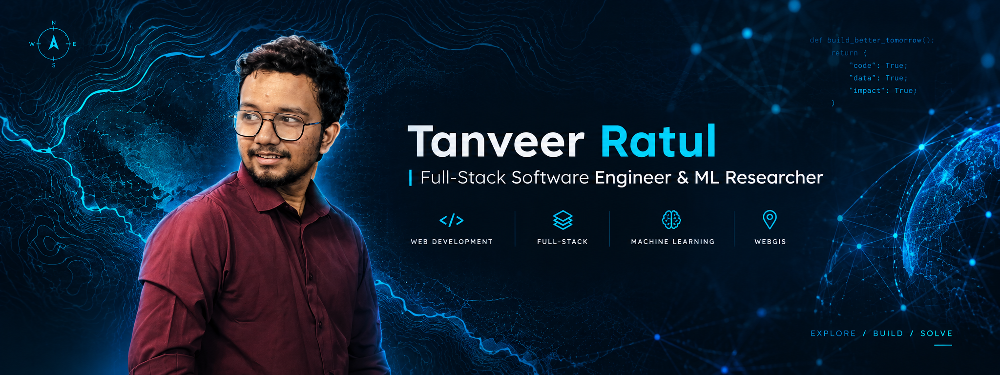

  

<h1 align="center">Hi 👋, I'm Tanveer</h1>
<h3 align="center">Full-Stack Software Engineer | Machine Learning Researcher | Designer</h3>

  I build robust web applications, explore geospatial data systems, and research deep learning models. Currently wrapping up my CSE degree at Notre Dame University Bangladesh and interning at CEGIS.

  <a href="https://tanveer-ratul-portfolio.vercel.app/"><strong>Portfolio</strong></a> · 
  <a href="YOUR_LINKEDIN_LINK"><strong>LinkedIn</strong></a> · 
  <a href="mailto:tanvirratul18@example.com"><strong>Email</strong></a>

---

### 🚀 About Me
- 🔭 **Currently working on:** A WebGIS application utilizing Angular, React, and .NET for geospatial data processing.
- 🧠 **Researching:** Bengali Automatic Speech Recognition (ASR) using Wav2Vec2-BERT and fine-tuned Bangla T5 LLMs for my undergrad thesis.
- 🌱 **Currently learning:** Advanced UI/UX workflows in Figma to complement my full-stack development.
- 💻 **Recent ships:** An interactive Student Result Management System with Highcharts GeoJSON mapping, and a full-stack ASP.NET Core API for employee management.
- 🎨 **Beyond Code:** I run an e-commerce brand, TECH RAJJO, and have 8 years of freelance experience in video editing (Premiere Pro) and graphic design. 

---

### 🛠️ Tech Stack & Tools

**Languages & Frameworks**

  
  
  
  
  
  

**Databases & Machine Learning**

  
  
  

**Design & Media**

  
  
  

---

### 📊 GitHub Analytics

  
  

 

  

